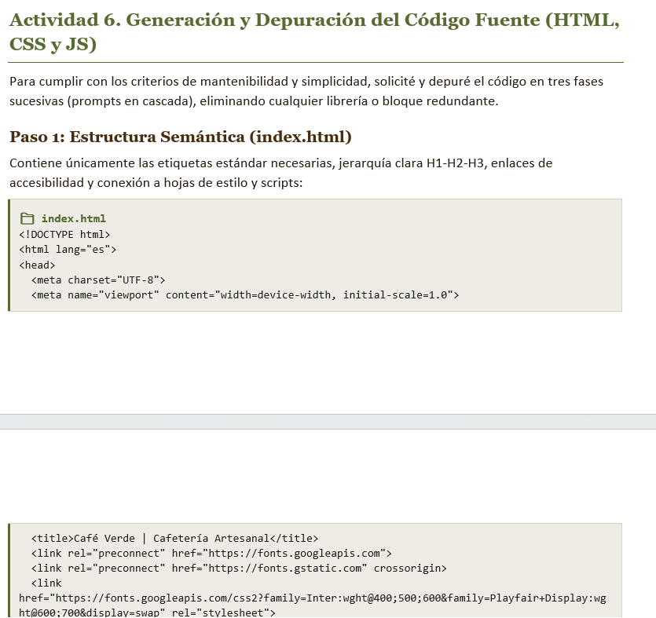

TALLER PRÁCTICO: USO DE LA IA EN PROYECTOS WEB
Propuesta de Diseño, Prompt Engineering y Maquetación Web Funcional
Caso de Estudio: Café Verde | Cafetería Artesanal
Estudiante: Jazmín | Tecnologías: HTML5 , CSS3 , JavaScript

Actividad 1. Definición del Proyecto Web (Brief del Proyecto)
Como desarrolladora web, convertí la necesidad planteada por el cliente en un brief técnico estructurado resolviendo las cuatro preguntas fundamentales:

1. Propósito
   El sitio web de Café Verde tiene como propósito principal informar a los clientes sobre la filosofía artesanal de la cafetería, exhibir un menú digital visual y conciso con precios claros, facilitar la ubicación geográfica exacta con horarios de apertura y habilitar canales de contacto directo para reservas e inquietudes.
2. Audiencia
   Público entre 20 y 55 años, compuesto por profesionales, trabajadores remotos, estudiantes universitarios y residentes de la zona con interés en el café de especialidad y la gastronomía artesanal. El 80% de la navegación proyectada provendrá de dispositivos móviles (smartphones) mientras buscan un lugar acogedor para reunirse o trabajar.
3. Contenido y Secciones
   • Encabezado y Navegación: Logotipo tipográfico y menú de anclaje rápido responsive.
   • Hero / Inicio: Frase representativa de marca, imagen inmersiva y llamada a la acción hacia el menú.
   • Nuestra Historia: Bloque conciso que comunica la dedicación, selección de granos y pilares artesanales.
   • Menú de Productos: Cuadrícula organizada con productos esenciales (espresso, cappuccino, cold brew, croissant, brownie, tostada) con imagen, descripción y precio.
   • Ubicación y Horarios: Dirección visible, referencias de llegada, horarios semanales y mapa incrustado.
   • Contacto: Formulario con validación nativa y botón de acción directa hacia WhatsApp.
   • Pie de página: Enlaces a redes sociales y créditos de autoría.
4. Estética y Sistema Visual
   • Paleta de Colores: Verde oliva (#556B2F) como acento primario; Crema (#FBF9F5) para fondo limpio; Marrón cálido tostado (#4A2C11) para textos y títulos; Beige (#E8DFD8) para bordes de tarjetas.
   • Tipografía: Serif refinada (Playfair Display) en títulos para proyectar tradición y calidez; Sans-serif limpia (Inter) en párrafos para máxima legibilidad.
   • Recursos Visuales: Fotografías reales de café y repostería en tonos cálidos y naturales, evitando ilustraciones 3D o elementos artificiales.
   
4. | col1 | col2 | col3 |
   | ---- | ---- | ---- |
   |      |      |      |
   |      |      |      |

   Actividad 2. Preparación del Contexto con Priming
   Para iniciar el trabajo con el asistente de IA, configuré su rol como desarrollador senior y establecí las restricciones tecnológicas y arquitectónicas antes de escribir cualquier línea de código.
   Prompt de Priming Aplicado:

"Actúa como un desarrollador frontend senior especializado en HTML semántico, CSS moderno y JavaScript básico. Estoy desarrollando un proyecto web cuyo propósito es presentar una cafetería artesanal y su menú con precios, captar visitas al local y facilitar el contacto directo, dirigido a amantes del café de especialidad y clientes locales que navegan en móviles y laptops.
El sitio debe incluir hero, historia, menú con tarjetas de productos, ubicación con mapa y formulario de contacto, y utilizar una estética acogedora en tonos verde oliva (#556B2F), crema (#FBF9F5) y marrón tostado (#4A2C11), con tipografía serif en títulos.
Su función será ayudarme a diseñar, maquetar y validar la propuesta. Trabaja con HTML, CSS y JavaScript puro, separando las tres tecnologías en archivos independientes. Prioriza la accesibilidad, la claridad del código, el diseño responsive y la facilidad de mantenimiento. No utilices frameworks externos ni generes funcionalidades innecesarias.
Primero ayúdame a definir la propuesta; después esperaremos mi aprobación para generar el código. Explica sus decisiones mediante resúmenes y criterios técnicos verificables. ¿Qué información adicional necesitas antes de comenzar?"

Evidencia y Respuestas de Análisis (Actividad 2):
• Información solicitada por la IA: El asistente solicitó aclarar el comportamiento del mapa (iframe de Google Maps o imagen estática), el método para organizar el menú (si requería filtros interactivos por pestañas o visualización corrida en cuadrícula) y los campos obligatorios del formulario.
• Delimitación del contexto: Sí, delimitó adecuadamente el rol profesional al prohibir librerías pesadas (Bootstrap, Tailwind o jQuery) y forzar la separación de responsabilidades en tres archivos estándar.
• Ambigüedades detectadas: Era necesario fijar los puntos de corte responsivos (breakpoints) y definir un límite realista de productos en el menú para no sobrecargar el DOM.
• Efecto de cambiar de contexto a mitad de desarrollo: Si se modificara el propósito o el tipo de usuario sin reiniciar el priming, la IA empezaría a proponer componentes innecesarios (como un carrito de compras complejo con pasarela de pago o logins de usuario) que violarían el tiempo y alcance del brief.

Actividad 3. Aplicación de Meta-Prompting
Antes de saltar a la codificación, utilicé la técnica de meta-prompting para que la IA estructurara la plantilla ideal de solicitud, garantizando que ninguna restricción crítica quedara por fuera.
Prompt de Meta-Prompting Enviado:

"Quiero crear una propuesta profesional de diseño y maquetación web para el proyecto que te describí. Antes de generar la propuesta, indícame cuál sería la mejor estructura de un prompt para obtener un resultado preciso. Identifica los datos que necesitas sobre el diseño visual, las secciones, la navegación, las interacciones, las imágenes y la adaptación a dispositivos móviles. Devuélveme una plantilla organizada por campos, señala qué información falta en mi brief y formula las preguntas necesarias para completarlo. No generes todavía HTML, CSS ni JavaScript."

Resultado y optimización obtenida: La IA devolvió una estructura por bloques (Identidad > Paleta HEX > Breakpoints > Componentes UI > Criterios de Validación). Gracias a esta plantilla, añadí explícitamente el soporte de accesibilidad básica (etiquetas label vinculadas, contraste WCAG AA en botones, atributos aria-expanded en el menú hamburguesa) y el comportamiento Mobile-First antes de autorizar el diseño definitivo.

Actividad 4. Experimentación y Comparación de las Cuatro Técnicas de Prompting

| Técnica            | Prompt Utilizado | Registro y Análisis del Resultado |
| ------------------- | ---------------- | ---------------------------------- |
| **Zero-shot** |                  |                                    |

*(Sin ejemplos)* | "Diseña la propuesta visual de una página web para Café Verde, una cafetería artesanal. Define las secciones, su orden, una paleta con HEX, la tipografía y las principales interacciones. Presenta la propuesta en una estructura organizada. No utilices ejemplos de otros sitios." | La IA asumió por su cuenta secciones genéricas como 'Testimonios' y 'Galería de Instagram'. Aunque los colores propuestos fueron acertados, la estructura fue muy abierta, genérica y poco predecible en el layout final.

 |
| **One-shot**

*(Un ejemplo de referencia)* | "Ejemplo de referencia: sección de servicios con título a la izquierda, descripción y 3 tarjetas en fila con icono, título y botón. En móvil se apilan. Diseña Café Verde adaptando este patrón visual para la sección del menú. Conserva el patrón de jerarquía visual y explica qué partes reutilizaste." | La IA replicó con precisión el patrón de 3 columnas para los productos del menú, reemplazando los íconos por tazas de café y postres con botón. Funcionó muy bien para ese bloque individual, pero no homogeneizó el resto de las secciones.

|
| **Few-shot**

*(Múltiples referencias)* | "Referencias: (1) Tarjetas con fondo blanco y sombra suave. (2) Botones verde oliva con hover visible. (3) Secciones con título serif, descripción y grid responsive. Diseña la propuesta visual completa de Café Verde siguiendo estas convenciones para mantener consistencia en componentes." | Consistencia visual total en toda la interfaz. Logró unificar los botones de acción, las tarjetas de café y los campos de contacto bajo una misma identidad gráfica. Resultó la técnica más sólida para crear un sistema de diseño armónico.

 |
| **Chain of Thought**

*(Paso a paso / Razonamiento)* | "Antes de generar la propuesta visual de Café Verde, presenta un plan de trabajo con 5 etapas: 1. Necesidades, 2. Secciones, 3. Colores y fuentes, 4. Interacciones, 5. Adaptación responsive. Justifica cada decisión técnica antes de entregar la propuesta final." | Excelente técnica para justificar técnicamente cada decisión antes de codificar. La IA argumentó el uso de CSS Grid sobre Flexbox en el menú para prevenir saltos de línea asimétricos y descartó modales pesados en móviles en favor de una navegación más ágil.

 |

Actividad 5. Consolidación de la Propuesta Visual Aprobada
Integrando el razonamiento de Chain of Thought y las convenciones de Few-shot, formulé el prompt profesional definitivo y aprobé la arquitectura técnica:
Especificación Técnica Consolidada:

• Arquitectura Semántica: 

6:

<header></header>

<header></header>

<header></header>

<header></header>

<header></header>

 fijo con navegación responsive,  con 5 secciones idénticas al brief (#inicio, #historia, #menu, #ubicacion, #contacto) y  centrado.
• Tokens de Estilo: Variables nativas CSS (--color-primary: #556B2F, --color-bg: #FBF9F5, --color-surface: #FFFFFF, --color-text: #4A2C11, --color-border: #E8DFD8).
• Tipografías del Sistema: Playfair Display (600, 700) para H1 y H2; Inter (400, 500, 600) para cuerpo de texto y botones.
• Layout Responsivo: Mobile-First con breakpoints verificados en 360 px (columna única), 768 px (2 columnas) y 1024-1200 px (3 columnas en menú).
• Interacciones JS Requeridas: Menú desplegable accesible para móviles y validación de formulario en cliente con retroalimentación sin recargar página.
